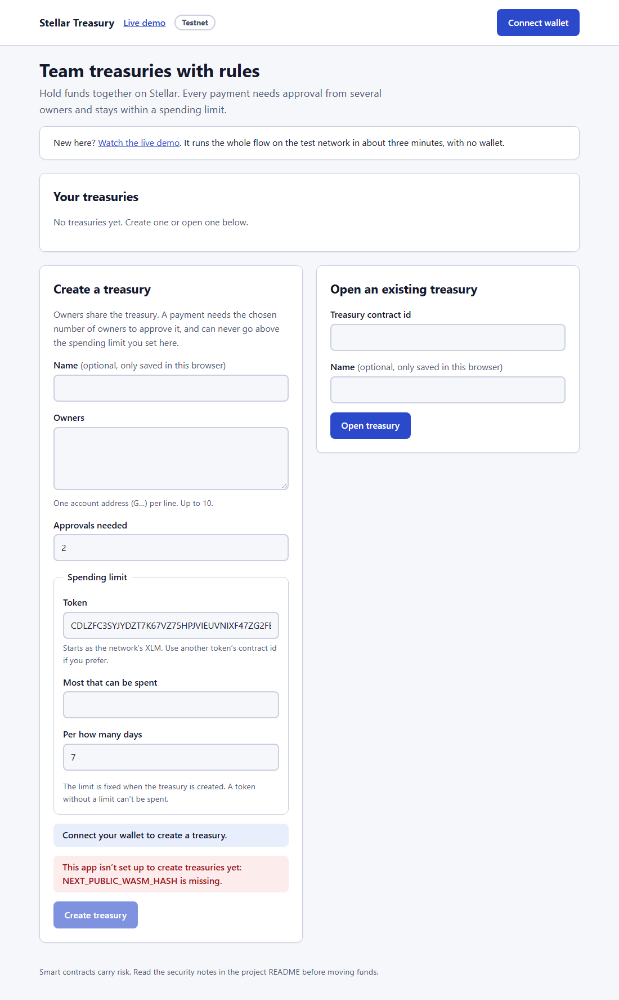
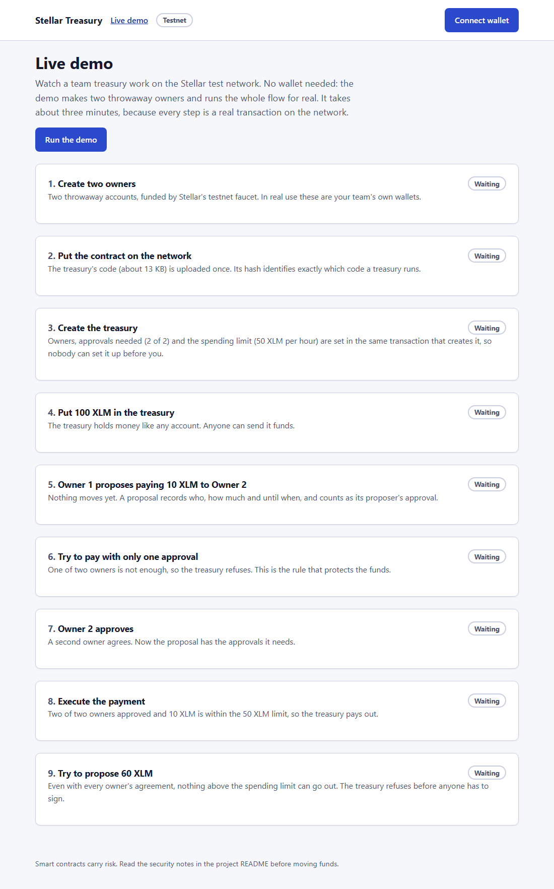
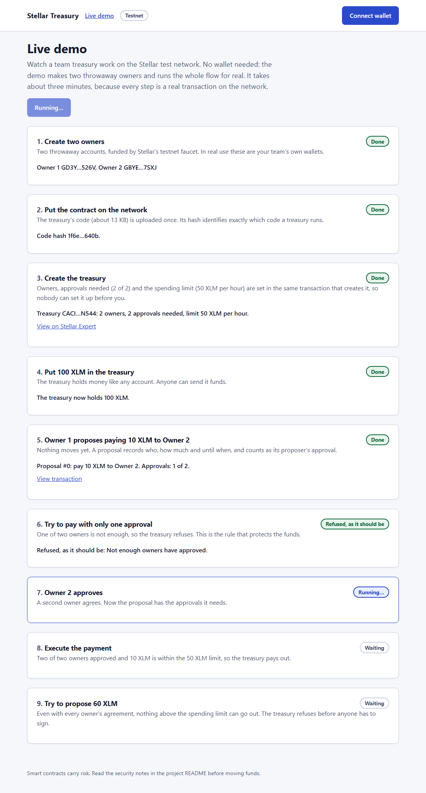
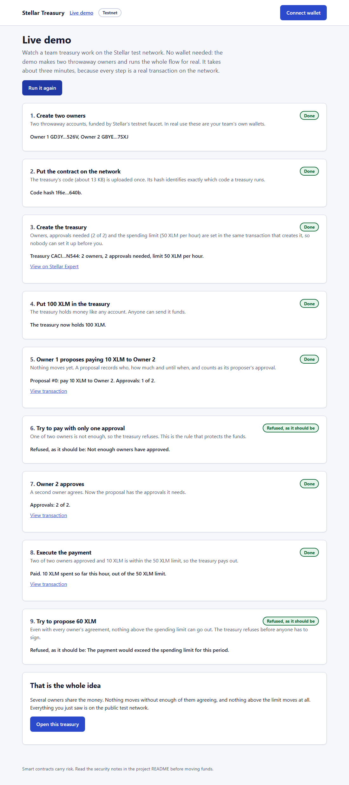
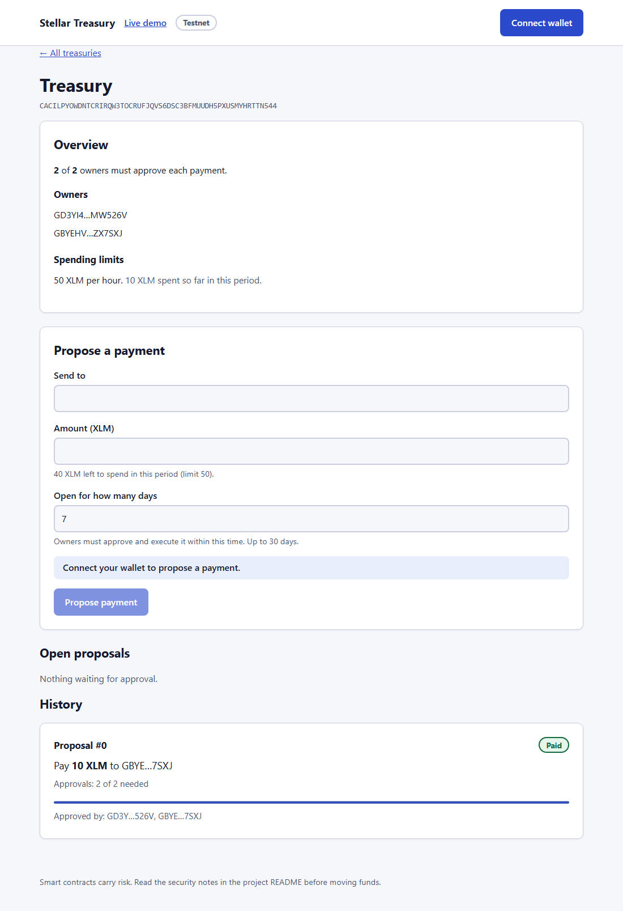

# Stellar Treasury: demo

**Team wallets on Stellar where payments need several owners to agree, and a spending limit applies even when they all do.**

**Try it now: [soroban-treasury.github.io/Frontend/demo](https://soroban-treasury.github.io/Frontend/demo/)**, then press **Run the demo**. No wallet needed.

There are three ways to see it, from quickest to most thorough.

| | What | Time | Needs |
|---|---|---|---|
| **1. Live demo page** | One button in the app runs the whole flow on the Stellar test network, step by step, with links to every transaction | about 3 min | A browser. No wallet |
| **2. Terminal demo** | The same flow from the SDK, printed in the terminal | about 2 min | Node 20+ and the built contract |
| **3. Full app** | Create your own treasury and approve payments with the Freighter wallet | 10 min | The Freighter extension and testnet XLM |

## The problem

Teams and DAOs on Stellar share funds with plain multisig. Multisig checks signatures, and nothing else: when enough keys sign, any amount can leave. There is no per-period cap, no record of who proposed what, and no review step.

## What it does

An **owners-and-threshold treasury** with rules that go beyond multisig:

1. An owner **proposes** a payment (who, how much, until when).
2. Other owners **approve** it, until the required number is reached.
3. An owner **executes** it. The contract pays only if the amount fits that token's **spending limit for the current period**.

Everything is enforced by a Soroban contract. Setup (owners, approvals needed, limits) happens in the contract's constructor, in the same transaction that deploys it, so nobody can set it up before you.

## 1. Live demo page

Open the [live demo](https://soroban-treasury.github.io/Frontend/demo/), or click **Live demo** in the app's header. To run the app on your own computer instead:

```
git clone https://github.com/Soroban-Treasury/Frontend.git
cd Frontend
npm install
npm run dev        # http://localhost:4000, then open /demo
```

Then press **Run the demo**. It creates two throwaway owners (funded by the testnet faucet), uploads the contract code if testnet does not have it yet, creates a 2-of-2 treasury with a 50 XLM per hour limit, and runs the flow. The nine steps:

| # | Step | What it proves |
|---|---|---|
| 1 | Create two owners | Real accounts, funded on testnet |
| 2 | Put the contract on the network | The 13 KB contract is uploaded; its hash identifies the code |
| 3 | Create the treasury | Owners, 2 approvals and a 50 XLM limit are set at deployment |
| 4 | Put 100 XLM in | It holds funds like any account |
| 5 | Owner 1 proposes paying 10 XLM to Owner 2 | Nothing moves yet; a proposal is recorded |
| 6 | Try to pay with one approval | **Refused**: not enough owners approved |
| 7 | Owner 2 approves | The second approval |
| 8 | Execute | Paid, within the limit |
| 9 | Try to propose 60 XLM | **Refused**: above the spending limit, before anyone signs |

Each step has a link to the transaction on Stellar Expert, and when it finishes, **Open this treasury** shows the real on-chain state.











## 2. Terminal demo

Needs the [Stellar CLI](https://developers.stellar.org/docs/tools/cli) and Node 20+. Clone the two repos side by side with these folder names, so the SDK finds the built contract:

```
git clone https://github.com/Soroban-Treasury/Contract.git contract
git clone https://github.com/Soroban-Treasury/SDK.git sdk
cd contract && stellar contract build
cd ../sdk && npm install && npm run build && npm run demo
```

It runs the same flow through the SDK and prints each result. A recorded run is in [terminal-run.txt](terminal-run.txt).

## 3. Full app with a wallet

1. Install the [Freighter](https://www.freighter.app/) browser wallet, switch it to **Testnet**, and fund the account at the [Stellar Lab friendbot](https://lab.stellar.org/account/fund).
2. In the app, **Connect wallet**, then **Create a treasury**: add owner addresses, choose approvals needed and a spending limit.
3. Fund the treasury with some testnet XLM, **Propose a payment**, approve it with each owner's wallet, and **Execute**.

## A 3-minute video script

If the submission wants a recording, this fits in three minutes:

| Time | Show | Say |
|---|---|---|
| 0:00 | Home page | "Teams share money on Stellar with multisig. Multisig only checks signatures. Stellar Treasury adds approvals, a record of every proposal, and a spending limit." |
| 0:20 | Click Live demo, press Run | "This runs for real on the Stellar test network. I don't need a wallet: it makes two throwaway owners." |
| 0:40 | Steps 1 to 4 appear | "Two owners, a 2-of-2 treasury with a 50 XLM per hour limit set at creation, and 100 XLM inside." |
| 1:15 | Step 6, first refusal | "One owner proposed a payment. One approval is not enough, and the contract refuses." |
| 1:40 | Steps 7 and 8 | "The second owner approves. Now it pays, because it is within the limit." |
| 2:00 | Step 9, second refusal | "Even if both owners agree, 60 XLM is above the limit, so it is refused before anyone signs." |
| 2:20 | Click a Stellar Expert link, then Open this treasury | "Every step is a real transaction. The app reads the treasury state straight from the chain." |
| 2:45 | Back to the home page | "The contract, an SDK, an API with an activity log and this app are all open source." |

## Verify it yourself

- **Contract on testnet:** [`CBK7HRYROYMGDFPN2ISHW7NHK7O4Z4TVGK4S3HJTKGZX6ZX5A7QFBWRI`](https://stellar.expert/explorer/testnet/contract/CBK7HRYROYMGDFPN2ISHW7NHK7O4Z4TVGK4S3HJTKGZX6ZX5A7QFBWRI), deployed with `scripts/deploy.sh` and recorded in `contract/deployments/testnet.json`.
- **Code hash:** `1f6e5b53c3ad153ac813a0f15beeac352b7e72b8731737f69e50d2c7bf1b640b`. Build the contract (`scripts/build.sh`) and compare the SHA-256 it prints.
- Every demo run creates a new treasury. Its link is shown in step 3.

## What is in the project

| Part | What | Tests |
|---|---|---|
| [contract](https://github.com/Soroban-Treasury/Contract) | Soroban contract in Rust: owners, threshold, spending limits, proposals, events | 30 |
| [sdk](https://github.com/Soroban-Treasury/SDK) | TypeScript client with typed errors, runs in Node and the browser | 33 |
| [backend](https://github.com/Soroban-Treasury/Backend) | Event indexer, SQLite, HTTP API, signed webhooks, audit log | 42 |
| [frontend](https://github.com/Soroban-Treasury/Frontend) | Next.js app, accessible, light and dark themes | 68 |

Docs for the contract: [storage and events](https://github.com/Soroban-Treasury/Contract/blob/main/docs/STORAGE.md), [deployments](https://github.com/Soroban-Treasury/Contract/blob/main/docs/DEPLOYMENTS.md), [testing](https://github.com/Soroban-Treasury/Contract/blob/main/docs/TESTING.md), [mainnet checklist](https://github.com/Soroban-Treasury/Contract/blob/main/docs/MAINNET_READINESS.md), and an [internal pre-audit](https://github.com/Soroban-Treasury/Contract/blob/main/Audits/pre-audit-2026-11-04.md).

## Status

- Works end to end on Stellar testnet. The demo above is that flow, run live.
- The contract has an internal pre-audit and is ready for an independent audit. Mainnet follows the checklist in `MAINNET_READINESS.md`, and `deploy.sh mainnet` asks for the audit report link.
- Next: changing spending limits after creation with several owners' signatures, a recipient allowlist, a timelock and batch payments.
